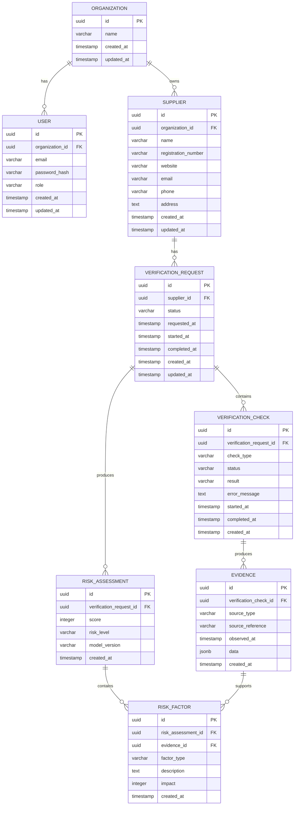

# Entity Relationship Diagram — V1

## Overview

The Supplier Assurance Platform uses a relational data model centered around organizations, suppliers, verification workflows, evidence, and risk assessments.

The V1 model is intentionally limited to the entities required for the initial product scope.

The model will evolve as new requirements are introduced. Future capabilities such as document processing, asynchronous jobs, AI analysis, notifications, and advanced audit logging will introduce additional entities only when those capabilities are actually implemented.

---

## V1 ER Diagram



---

## Entity Responsibilities

### 1. Organization

Represents a business or tenant using the platform.

An organization owns its users and suppliers.

The organization acts as the primary tenant boundary for V1.

```text
Organization
    |
    +-- Users
    |
    +-- Suppliers
```

---

### 2. User

Represents an authenticated platform user.

A user belongs to exactly one organization.

V1 supports two basic roles:

* `ADMIN`
* `USER`

The initial implementation intentionally avoids complex role-based access control.

#### Constraints

Email addresses should be unique within an organization.

```text
UNIQUE(organization_id, email)
```

---

### 3. Supplier

Represents a supplier being evaluated by an organization.

A supplier belongs to exactly one organization.

Supplier information includes:

* Name
* Registration number
* Website
* Email
* Phone
* Address

The registration number should be unique within an organization when provided.

```text
UNIQUE(organization_id, registration_number)
```

The same supplier may therefore exist in multiple organizations because different organizations may independently evaluate the same business.

---

### 4. Verification Request

Represents one historical attempt to verify a supplier.

A supplier can have multiple verification requests over time.

For example:

```text
Supplier
    |
    +-- Verification Request #1
    |
    +-- Verification Request #2
    |
    +-- Verification Request #3
```

This allows the platform to preserve verification history rather than overwriting previous results.

#### Example lifecycle

```text
REQUESTED
    |
    v
IN_PROGRESS
    |
    +------> FAILED
    |
    v
COMPLETED
```

`CANCELLED` may be introduced if required by the workflow.

---

### 5. Verification Check

Represents one specific verification operation within a verification request.

Examples:

* GST / registration verification
* Company registration verification
* Website reachability
* Name consistency
* Address consistency

One verification request can contain multiple checks.

```text
Verification Request
    |
    +-- GST Verification
    +-- Company Registry Verification
    +-- Website Check
    +-- Name Consistency Check
    +-- Address Consistency Check
```

A technical check failure does not automatically mean that the supplier is fraudulent.

For example:

```text
Website unavailable
```

is different from:

```text
Registration record not found
```

The risk engine interprets these outcomes separately.

---

### 6. Evidence

Evidence represents information observed during a verification process.

Evidence is intentionally modeled as a first-class entity rather than storing only boolean verification flags.

For example, instead of:

```text
gst_verified = true
```

the platform can store:

```text
Source:
GST / Registration Provider

Observed At:
2026-10-07T10:30:00Z

Data:
{
    "legalName": "ABC Technologies Private Limited",
    "status": "ACTIVE",
    "registrationDate": "2021-04-12"
}
```

Evidence can originate from:

* `SUPPLIER_INPUT`
* `GST_PORTAL`
* `COMPANY_REGISTRY`
* `WEBSITE`
* `SUPPLIER_DOCUMENT`
* `AUTHORIZED_PROVIDER`

The exact enum values may evolve during implementation.

#### Evidence data

The `data` field is planned as PostgreSQL `JSONB`.

This is intentional because different verification sources produce different data structures.

For example:

```json
{
  "legalName": "ABC Technologies Private Limited",
  "status": "ACTIVE"
}
```

and:

```json
{
  "httpStatus": 200,
  "https": true,
  "responseTimeMs": 342
}
```

can both be stored without creating a separate table for every evidence format.

---

### 7. Risk Assessment

Represents the risk evaluation generated from a completed verification workflow.

A verification request may have multiple risk assessments over time.

This allows the system to preserve historical assessments when the scoring model changes.

Each assessment stores:

* Score
* Risk level
* Model version
* Creation timestamp

The `model_version` field is important for reproducibility.

For example:

```text
Risk Model v1.0
Score: 35
Risk Level: MEDIUM
```

If the scoring rules later change:

```text
Risk Model v2.0
Score: 45
Risk Level: MEDIUM
```

the historical assessment remains associated with the model version that produced it.

---

### 8. Risk Factor

Represents one reason that contributed to a risk assessment.

A risk factor contains:

* Factor type
* Description
* Impact
* Supporting evidence

Example:

```text
Factor Type:
ADDRESS_MISMATCH

Impact:
+15

Description:
Supplier-provided address differs from registered address.
```

The risk factor references the evidence supporting the conclusion.

This creates the explainability chain:

```text
Risk Assessment
       |
       v
Risk Factor
       |
       v
Evidence
       |
       v
Source
```

This relationship is one of the most important design decisions in the V1 model because it prevents the risk score from becoming an unexplained number.

---

## Relationship Summary

### Organization → User

```text
One Organization
        |
        +----> Many Users
```

A user belongs to one organization.

---

### Organization → Supplier

```text
One Organization
        |
        +----> Many Suppliers
```

A supplier belongs to one organization.

---

### Supplier → Verification Request

```text
One Supplier
        |
        +----> Many Verification Requests
```

A supplier can be verified multiple times.

---

### Verification Request → Verification Check

```text
One Verification Request
        |
        +----> Many Verification Checks
```

Each verification request consists of multiple independent checks.

---

### Verification Check → Evidence

```text
One Verification Check
        |
        +----> Many Evidence Records
```

A check can produce multiple pieces of evidence.

---

### Verification Request → Risk Assessment

```text
One Verification Request
        |
        +----> Many Risk Assessments
```

Multiple assessments are allowed to preserve historical results across different risk model versions.

---

### Risk Assessment → Risk Factor

```text
One Risk Assessment
        |
        +----> Many Risk Factors
```

A risk assessment is explained through its individual risk factors.

---

### Evidence → Risk Factor

```text
One Evidence Record
        |
        +----> Many Risk Factors
```

The same evidence may support multiple risk factors.

---

## Tenant Isolation

Tenant isolation is enforced through the organization relationship.

The main ownership chain is:

```text
Organization
      |
      +---- User
      |
      +---- Supplier
               |
               +---- Verification Request
                        |
                        +---- Verification Check
                                 |
                                 +---- Evidence
```

Risk assessments and risk factors are connected through the verification request and evidence relationships.

The application must ensure that a user can only access records belonging to their organization.

For example:

```text
Organization A
    |
    +-- Supplier A
         |
         +-- Verification A
              |
              +-- Evidence A


Organization B
    |
    +-- Supplier B
         |
         +-- Verification B
              |
              +-- Evidence B
```

A user from Organization A must never be able to retrieve Supplier B or its associated verification information.

---

## Database Design Decisions

The V1 database follows these decisions.

### Primary Keys

All core entities use UUID primary keys.

Example:

```text
id UUID PRIMARY KEY
```

UUIDs will be generated by the application using Java's UUID support.

---

### Enum Storage

Domain enums such as status, role, check type, and risk level will initially be stored as `VARCHAR`.

For example:

```text
status VARCHAR(50)
```

The Java application will map these values using:

```java
@Enumerated(EnumType.STRING)
```

PostgreSQL-specific ENUM types are intentionally avoided in V1 to keep schema evolution simpler.

---

### Timestamps

All timestamps are stored in UTC.

PostgreSQL will use:

```text
TIMESTAMP WITH TIME ZONE
```

The Java application will use:

```java
Instant
```

---

### Evidence JSON

Evidence-specific structured data will be stored using PostgreSQL `JSONB`.

```text
data JSONB
```

This provides flexibility while keeping the evidence itself associated with a strongly typed verification check.

---

### Delete Strategy

V1 will use hard deletes where deletion is required.

Soft-delete fields such as:

```text
deleted_at
is_deleted
```

are intentionally not included at this stage.

Soft deletion can be introduced later if business, compliance, or audit requirements justify it.

---

## Organization ID on Verification Request

The V1 model does not duplicate `organization_id` directly on `VERIFICATION_REQUEST`.

The organization can be derived through:

```text
VERIFICATION_REQUEST
        |
        v
SUPPLIER
        |
        v
ORGANIZATION
```

This avoids storing the same tenant relationship in multiple places.

If future query performance, security enforcement, or reporting requirements justify denormalizing the organization reference, the schema can be evolved through a later migration.

---

## Why the Model Is Intentionally Small

The ER diagram does not currently include tables for:

* Documents
* Audit logs
* Notifications
* Processing attempts
* Verification events
* AI analysis
* Embeddings
* API keys
* External provider configurations

These are intentionally excluded because they are not required by the V1 product workflow.

They should be introduced only when the corresponding feature is actually implemented.

For example:

```text
V1
Supplier
    |
    +-- Verification
    +-- Evidence
    +-- Risk Assessment
```

Later:

```text
V2
Supplier
    |
    +-- Documents
    |
    +-- Verification
          |
          +-- Processing Attempts
          +-- Events
    |
    +-- Evidence
    +-- Risk Assessment
          |
          +-- AI Analysis
```

This keeps the initial system understandable while allowing the architecture to evolve.

---

## Future Evolution

Potential future entities may include:

* `DOCUMENT`
* `AUDIT_LOG`
* `VERIFICATION_EVENT`
* `PROCESSING_ATTEMPT`
* `AI_ANALYSIS`
* `DOCUMENT_CHUNK`
* `EMBEDDING`
* `NOTIFICATION`

These will be introduced through versioned database migrations only when the corresponding requirements are implemented.

---

## Schema Evolution

The database schema will be managed using Flyway.

The initial schema will be introduced through:

```text
V1__create_initial_schema.sql
```

Future changes will use additional migrations:

```text
V2__add_documents.sql
V3__add_audit_logs.sql
V4__add_processing_attempts.sql
```

Existing migrations should not be modified after they have been applied to a shared environment.

Database evolution should happen through new migrations.

---

## Current V1 Model

The complete V1 domain relationship can be summarized as:

```text
                    ORGANIZATION
                    /          \
                   /            \
                  v              v
                USER          SUPPLIER
                                  |
                                  v
                       VERIFICATION_REQUEST
                              /          \
                             /            \
                            v              v
                VERIFICATION_CHECK    RISK_ASSESSMENT
                         |                    |
                         v                    v
                      EVIDENCE           RISK_FACTOR
                         ^                    |
                         |____________________|
```

The central principle of the model is:

> Verification results should be explainable through evidence, and risk assessments should be traceable back to that evidence.
